<div align="center">

# NeuraNet

**AI-powered network intrusion detection with a real-time security operations dashboard**

[](https://github.com/omarrezma/neuranet/actions/workflows/ci.yml)
[](LICENSE)
[](neuranet-backend)
[](neuranet-frontend)
[](neuranet-backend)
[](docker-compose.yml)

[Overview](#overview) • [Features](#key-features) • [Screenshots](#screenshots) • [Architecture](#architecture) • [Installation](#installation) • [API](#api-endpoints) • [Security](#security) • [Roadmap](#roadmap)

</div>

---

## Overview

NeuraNet is a full-stack network security platform that captures live network traffic, extracts per-flow features, classifies each connection with a CNN-LSTM deep learning model, and surfaces the results through a real-time security operations dashboard.

It's a solo-built, end-to-end system covering everything between a raw packet on the wire and an analyst-facing alert: packet capture, flow reconstruction, feature engineering, model inference, a JWT-authenticated REST API, and a React SOC dashboard.

## Project Motivation

Most intrusion-detection demos stop at "here's a notebook that gets 98% accuracy on NSL-KDD." NeuraNet exists to go one step further and answer the harder, more realistic questions:

- How do you turn a trained classifier into something that scores **live traffic**, not a static test set?
- How do you get a prediction in front of a human in a way they can act on — alerts, incidents, confidence scores — instead of just a CSV of labels?
- What does it take to run that safely: authenticated API, no plaintext secrets, rate-limited login, containerized deployment?

Building the whole pipeline — not just the model — is what makes this a network/security engineering project rather than a machine-learning notebook.

## Key Features

- **Live packet capture & feature extraction** — Scapy-based `AsyncSniffer` tracks connections and derives NSL-KDD-style flow features in real time
- **CNN-LSTM intrusion classifier** — TensorFlow/Keras model with a scikit-learn preprocessing pipeline (scaling, feature selection, encoding)
- **Real-time SOC dashboard** — attack trend charts, live system status, network topology, and a security overview built with hand-rolled SVG visualizations
- **Device discovery & inventory** — automatic discovery of hosts on the local network, with live online/offline status
- **Alerts & incidents** — a reasoning-engine layer turns raw model predictions into human-readable incident explanations
- **JWT authentication** — every route except `/auth` requires a valid token; login is rate-limited against credential stuffing
- **Configurable, containerized** — Docker Compose brings up both services with environment-based configuration; no secrets in source

## Screenshots

### Dashboard & Monitoring

| Dashboard | Devices |
|---|---|
| 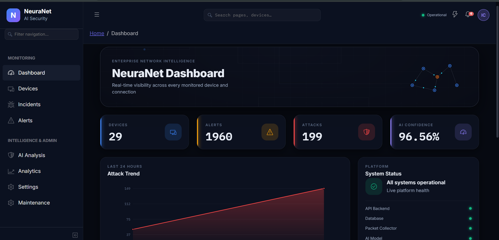 | 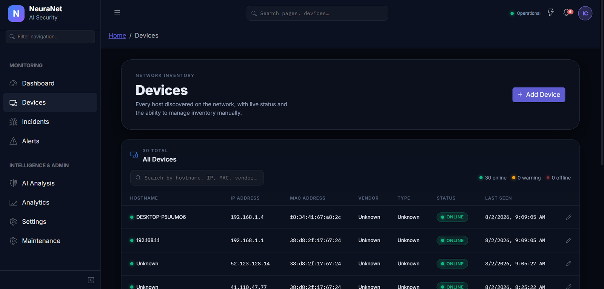 |

The dashboard surfaces live device/alert/attack counts, a rolling attack-trend chart, and per-service system health (API, database, packet collector, AI model) in one view. The Devices page lists every host discovered on the network with live status, MAC/vendor lookup, and manual inventory controls.

### Threat Detection & Analytics

| Alerts | Analytics |
|---|---|
| 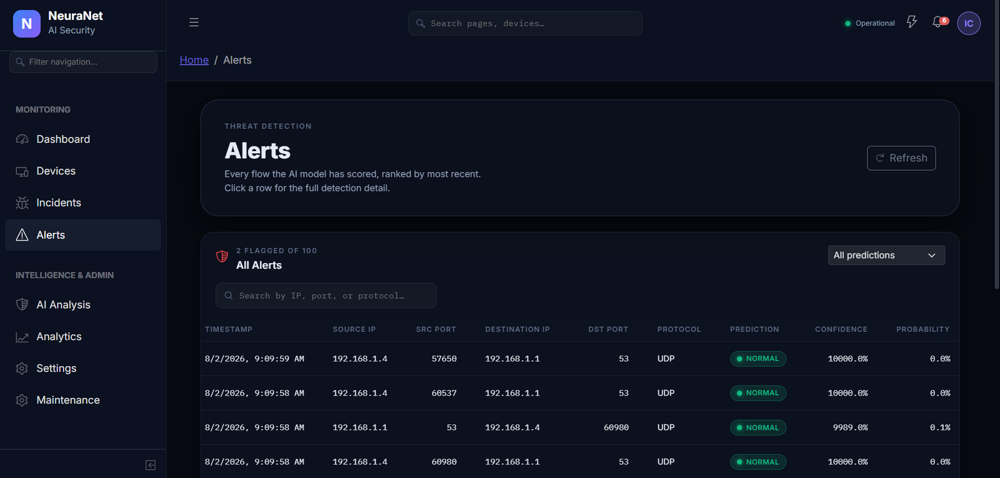 | 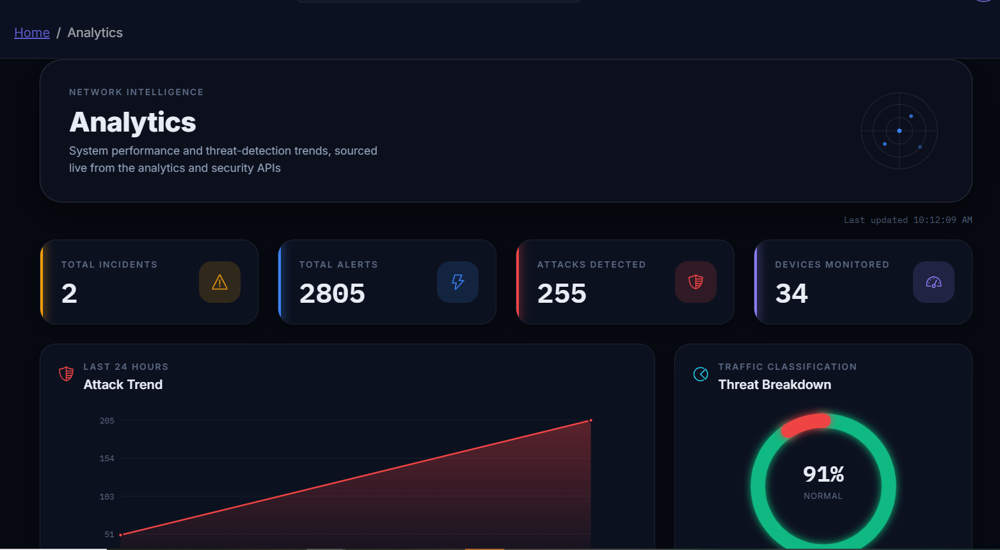 |

Every flow the model scores lands in Alerts, ranked by recency with source/destination IP, port, protocol, prediction, and confidence. Analytics rolls the same data up into trend charts and a normal/attack traffic breakdown. Flagged alerts are escalated into Incidents, where the reasoning-engine layer attaches a plain-language explanation (see [Key Features](#key-features)).

### AI Analysis

| AI Analysis | AI Analysis — Detail |
|---|---|
| 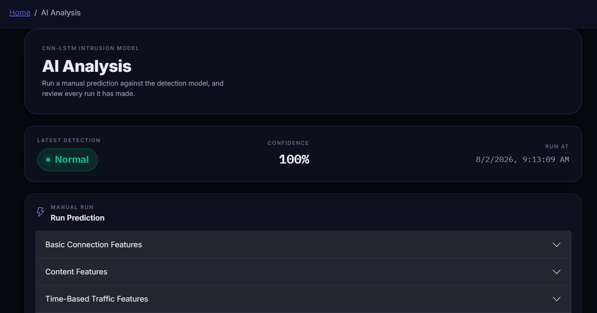 | 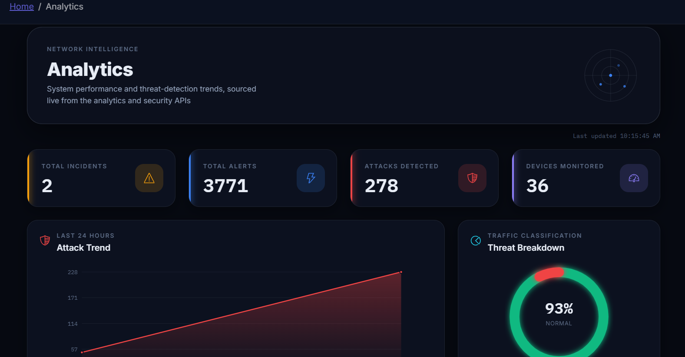 |

The AI Analysis page lets you run a manual prediction against the live model — expanding the same basic-connection, content, and time-based traffic feature groups the model was trained on — and review its prediction history.

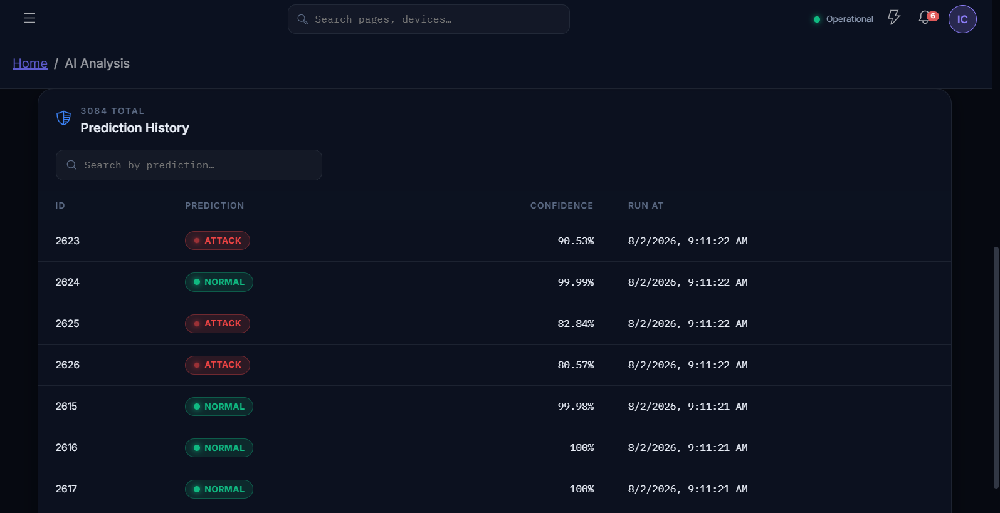

### Authentication

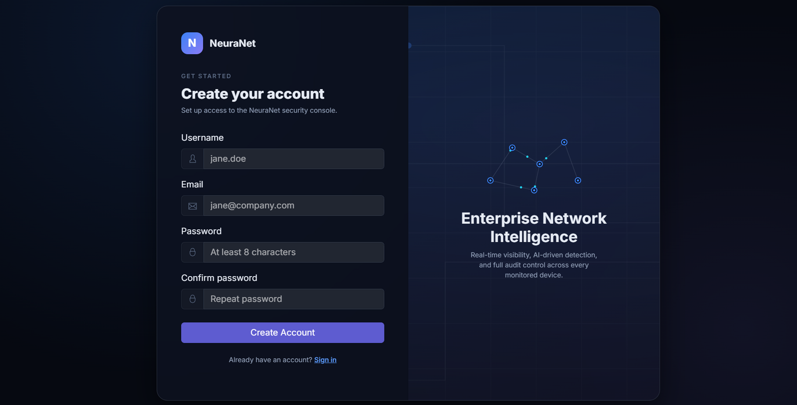

JWT-based auth in front of every protected route, with password strength requirements and rate-limited login.

<details>
<summary><strong>Landing page</strong></summary>

| Landing — hero | Landing — quick links | Landing — tech stack |
|---|---|---|
| 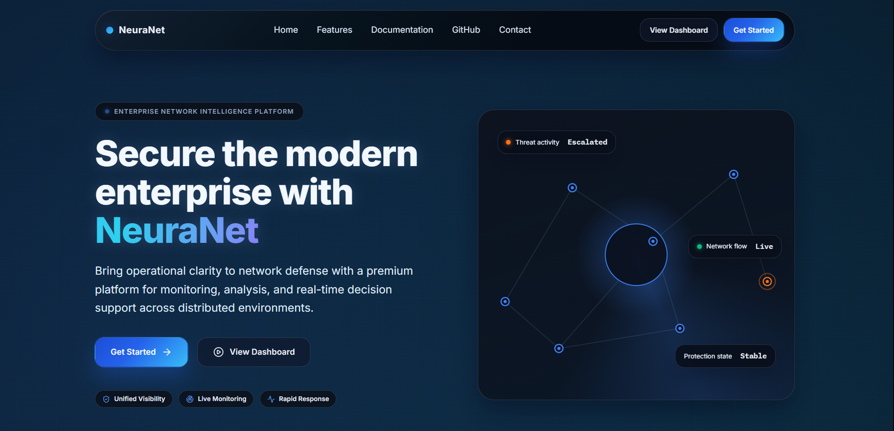 | 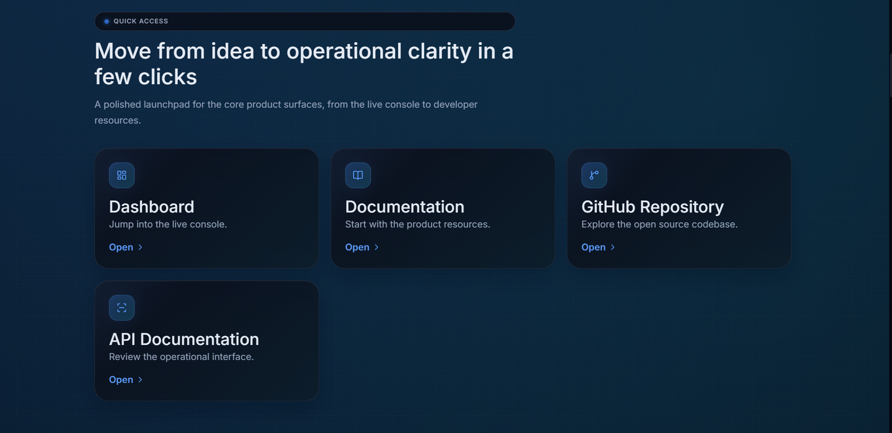 | 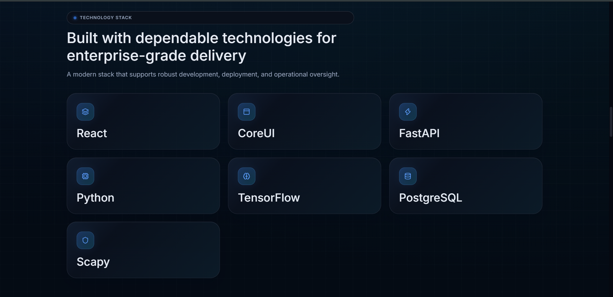 |

</details>

> The Incidents and Settings/Maintenance admin views also exist in the app but aren't pictured above — see [UI Notes](#ui--design-notes) for an honest read on what's demo-quality vs. production-quality.

## Architecture

```
neuranet/
├── neuranet-frontend/            React 19 SPA (Vite + CoreUI)
│   └── src/
│       ├── api/                   axios clients per resource (auth, devices, alerts, ...)
│       ├── components/             shared UI: charts, tables, cards, SVG visualizations
│       ├── views/                  dashboard, alerts, devices, analytics, incidents, analysis, settings, landing
│       └── routes/                 protected-route wrapper (JWT-gated)
│
├── neuranet-backend/              FastAPI application
│   └── app/
│       ├── ai/                     model loading, preprocessing, inference service
│       │   └── models/              trained CNN-LSTM (.h5) + scikit-learn pipeline (.pkl)
│       ├── collector/               live packet capture, flow tracking, feature extraction
│       ├── routers/                 REST endpoints (auth, devices, alerts, dashboard, ...)
│       ├── auth/                    JWT issuance/verification, bcrypt password hashing
│       ├── database/                 SQLAlchemy engine/session
│       ├── models/                   SQLAlchemy ORM models
│       ├── schemas/                   Pydantic request/response schemas
│       └── reasoning_engine/         turns predictions into human-readable incident analysis
│
├── docker-compose.yml              runs both services together
└── .github/workflows/ci.yml        backend pytest + frontend vitest/build on every push
```

**Request flow:** live packets → `collector/` extracts flow features → `ai/` preprocesses and scores them with the CNN-LSTM model → predictions above a threshold become `Alert` rows → `reasoning_engine/` generates a human-readable explanation → the React dashboard polls the REST API and renders it in real time.

A more detailed, annotated data-flow diagram and the reasoning behind each module boundary lives in **[`docs/architecture/README.md`](docs/architecture/README.md)**.

## Technology Stack

| Layer | Technology |
|---|---|
| Frontend | React 19, Vite, CoreUI, Redux, hand-rolled SVG data visualizations |
| Backend | FastAPI, SQLAlchemy 2.0, Pydantic v2, Uvicorn |
| Auth | JWT (python-jose), bcrypt via passlib, `slowapi` rate limiting |
| AI/ML | TensorFlow/Keras (CNN-LSTM), scikit-learn (scaling, feature selection) |
| Packet capture | Scapy (`AsyncSniffer`) |
| Database | SQLite (dev) / PostgreSQL (production-ready) |
| Testing | pytest + httpx (backend), Vitest + Testing Library (frontend) |
| DevOps | Docker, Docker Compose, GitHub Actions CI, Dependabot |

## Installation

### Prerequisites
- Python 3.12+
- Node.js 20+
- (Optional, for live packet capture) libpcap and root/`NET_ADMIN` privileges

### Backend

```bash
cd neuranet-backend
python -m venv venv && source venv/bin/activate   # Windows: venv\Scripts\activate
pip install -r requirements.txt

cp .env.example .env
# edit .env and set a real JWT_SECRET_KEY:
python -c "import secrets; print(secrets.token_hex(32))"

uvicorn app.main:app --reload
```

Interactive API docs (Swagger UI) are available at `http://localhost:8000/docs`.

### Frontend

```bash
cd neuranet-frontend
npm install
cp .env.example .env   # set VITE_API_URL if your backend isn't on localhost:8000
npm start
```

The app runs at `http://localhost:3000`.

## Docker

```bash
export JWT_SECRET_KEY=$(python3 -c "import secrets; print(secrets.token_hex(32))")
docker compose up --build
```

Frontend: `http://localhost:3000` · Backend: `http://localhost:8000`

- **Backend Dockerfile:** `python:3.12-slim`, installs `libpcap-dev`/`libpq-dev` for scapy and PostgreSQL support, runs as `uvicorn app.main:app`.
- **Frontend Dockerfile:** multi-stage — `node:20-slim` build stage, served by `nginx:1.27-alpine`.
- **`docker-compose.yml`** wires both services together, persists SQLite to a named volume, and requires `JWT_SECRET_KEY` to be set (it refuses to start otherwise — no default secret is baked in).

> Live packet capture inside a container needs elevated network capabilities (`--cap-add=NET_ADMIN --cap-add=NET_RAW`, or host networking). The default Compose setup runs the API without those privileges — fine for exploring the dashboard, incidents, and auth flow against seeded/manual data, but real packet capture requires the extra flags.

## Usage

1. Register a user via `/auth/register` (or the frontend Register page)
2. Log in — the frontend stores the JWT and attaches it to every API request
3. If a network interface is available, the collector auto-starts and begins scoring live traffic
4. Predictions above the alert threshold appear on the Dashboard and Alerts pages, with reasoning-engine explanations on the Incidents page
5. Browse Devices for discovered hosts, and Analytics for historical trends
6. Use AI Analysis to run a manual prediction against the model and inspect prediction history

## API Endpoints

All routes except `/auth/*` require `Authorization: Bearer <token>`.

| Method | Endpoint | Description |
|---|---|---|
| POST | `/auth/register` | Create a user account |
| POST | `/auth/login` | Authenticate, returns a JWT (rate-limited: 5/min/IP) |
| GET | `/devices` | List discovered network devices |
| GET | `/alerts` | List generated alerts (paginated) |
| GET | `/incidents` | List incidents with reasoning-engine analysis |
| GET | `/api/stats`, `/api/security`, `/api/attack-trend`, `/api/dashboard-cards` | Dashboard aggregates |
| GET | `/analytics` | Historical analytics data |
| GET/POST | `/settings` | Read/update runtime settings (e.g. auto-start collector) |
| GET | `/system` | System health/resource metrics |
| GET/POST | `/collector` | Collector status and control |
| POST | `/ai/*` | Model inference endpoints |
| GET | `/health` | Liveness check (no auth) |

Full interactive documentation (all request/response schemas) is generated automatically by FastAPI at `/docs` (Swagger UI) and `/redoc`.

## Folder Structure

<details>
<summary>Full annotated tree (click to expand)</summary>

```
neuranet/
├── .github/
│   ├── ISSUE_TEMPLATE/          bug report, feature request, contact links
│   ├── workflows/ci.yml         backend + frontend CI
│   ├── dependabot.yml           weekly pip/npm/Actions dependency PRs
│   ├── labels.yml               label taxonomy
│   └── PULL_REQUEST_TEMPLATE.md
├── docs/
│   ├── screenshots/             application screenshots used in this README
│   └── architecture/            detailed data-flow diagram + design rationale
├── neuranet-backend/
│   ├── app/
│   │   ├── ai/                  model loading, preprocessing, prediction service, router
│   │   ├── auth/                 hashing, JWT issuance/verification, auth dependency
│   │   ├── collector/             packet capture, flow tracking, NSL-KDD feature extraction
│   │   ├── database/               SQLAlchemy engine/session
│   │   ├── models/                 SQLAlchemy ORM models (User, Device, Alert, Incident, ...)
│   │   ├── reasoning_engine/       prediction → human-readable incident explanation
│   │   ├── routers/                 REST endpoints, one module per resource
│   │   ├── schemas/                  Pydantic request/response models
│   │   ├── services/                  device discovery, incident management, network utils
│   │   ├── static/, templates/         minimal server-rendered fallback dashboard
│   │   ├── logging_config.py
│   │   └── main.py                     FastAPI app, lifespan, router wiring, CORS, rate limiter
│   ├── tests/                     pytest suite (auth, health)
│   ├── Dockerfile
│   ├── requirements.txt
│   ├── pytest.ini
│   └── .env.example
├── neuranet-frontend/
│   ├── src/
│   │   ├── api/                 axios clients, one per backend resource
│   │   ├── components/           shared cards, tables, SVG charts, layout chrome
│   │   ├── layout/, routes/        app shell, protected-route wrapper
│   │   ├── views/                  dashboard, devices, alerts, incidents, analysis, analytics, settings, maintenance, landing
│   │   └── scss/, styles/           CoreUI theme + custom styles
│   ├── public/
│   ├── Dockerfile
│   ├── nginx.conf
│   ├── package.json
│   └── .env.example
├── docker-compose.yml
├── CHANGELOG.md
├── CONTRIBUTING.md
├── CODE_OF_CONDUCT.md
├── SECURITY.md
├── LICENSE
└── README.md
```

</details>

## Security

- `/auth/login` is rate-limited (5 requests/minute per IP) to slow down credential-stuffing attempts
- All routers except `/auth` require a valid JWT (`app/auth/dependencies.py`)
- Passwords are hashed with bcrypt via passlib; the raw password is never logged or returned in any API response
- CORS origins are explicitly allow-listed via `CORS_ORIGINS`, never wildcarded
- No secrets are committed to source control — the app refuses to start without `JWT_SECRET_KEY` set
- JWTs are currently **not revocable** (no blocklist/refresh rotation) — acceptable for a single-tenant/MVP deployment, called out explicitly in the roadmap below

See **[SECURITY.md](SECURITY.md)** for the full disclosure process, scope, and documented accepted risks.

## Testing

```bash
# Backend
cd neuranet-backend
pytest

# Frontend
cd neuranet-frontend
npm test
```

Both suites run in CI on every push/PR — see [`.github/workflows/ci.yml`](.github/workflows/ci.yml). The backend suite covers health endpoints, register/login flow, duplicate-user rejection, wrong-password rejection, and protected-route auth enforcement. The frontend suite covers key shared components; it isn't yet a full component-by-component test suite (see [Roadmap](#roadmap)).

## Configuration

### Backend (`neuranet-backend/.env`)

| Variable | Description |
|---|---|
| `DATABASE_URL` | SQLAlchemy connection string (SQLite by default, PostgreSQL for prod) |
| `JWT_SECRET_KEY` | Required — app refuses to start without it |
| `JWT_ALGORITHM` | Default `HS256` |
| `ACCESS_TOKEN_EXPIRE_MINUTES` | Default `60` |
| `CORS_ORIGINS` | Comma-separated list of allowed frontend origins |
| `COLLECTOR_INTERFACE` | Network interface for live capture (blank = OS default) |
| `LOG_LEVEL` | Default `INFO` |

### Frontend (`neuranet-frontend/.env`)

| Variable | Description |
|---|---|
| `VITE_API_URL` | Backend base URL, e.g. `http://localhost:8000` |

## UI / Design Notes

An honest, senior-product-designer read of the current UI, kept here instead of oversold in the feature list above:

- **Strengths:** consistent dark SOC-dashboard aesthetic, clear information hierarchy on the Dashboard and Alerts pages, sensible use of color for severity/status (green=normal, red=attack), and a cohesive type scale across pages.
- **Spacing/density:** several data tables (Alerts, Devices, Prediction History) run edge-to-edge with tight row padding — fine for an analyst who wants density, but a touch more vertical padding and a sticky header would improve scannability on longer lists.
- **Empty/loading states:** worth auditing — tables with zero rows or a slow-loading collector should show an explicit empty/loading state rather than a blank table.
- **Responsiveness:** the dashboard and tables are built for a desktop analyst workflow; narrow-viewport behavior (tablet width) hasn't been verified and is a reasonable next step before calling the UI "responsive."
- **Landing page vs. app:** the marketing landing page (hero, feature grid, tech-stack section) is polished but visually distinct from the authenticated app shell — for a portfolio piece, consider whether the landing page adds more than it costs in maintenance surface, since the CoreUI-based console is the actual project.

## Roadmap

- [ ] Refresh-token flow and JWT revocation/blocklist
- [ ] Move trained model artifacts (`app/ai/models/*.pkl`, `*.h5`) out of source control and into a model registry or release asset
- [ ] Automated load testing on the packet-capture pipeline
- [ ] Role-based access control (analyst vs. admin)
- [ ] WebSocket-based live updates instead of polling on the dashboard
- [ ] E2E tests (Playwright) covering the login → alert → incident flow
- [ ] Expand frontend test coverage beyond shared components to full page-level views

## My Contributions

This project was designed and built end-to-end by me, including:

- The FastAPI backend, database schema, and JWT authentication
- The Scapy-based packet capture and flow-feature-extraction pipeline
- Training and integrating the CNN-LSTM intrusion-detection model
- The full React dashboard (built on top of the CoreUI Free React Admin Template, with custom views, charts, and data flows)
- Test suites, Docker packaging, and the CI pipeline
- The security hardening, documentation, and repository structure in this README and `CHANGELOG.md`

## License

This project is licensed under the [MIT License](LICENSE).

The frontend is built on top of the CoreUI Free React Admin Template (MIT licensed) — see `neuranet-frontend/LICENSE-COREUI` for the original template attribution.

## Contact

**Omar Rezma** — [omarrrezma@gmail.com](mailto:omarrrezma@gmail.com) · [LinkedIn](https://linkedin.com/in/omar-rezma-bb0256422) · [GitHub](https://github.com/omarrezma)

Project link: [https://github.com/omarrezma/neuranet](https://github.com/omarrezma/neuranet)
